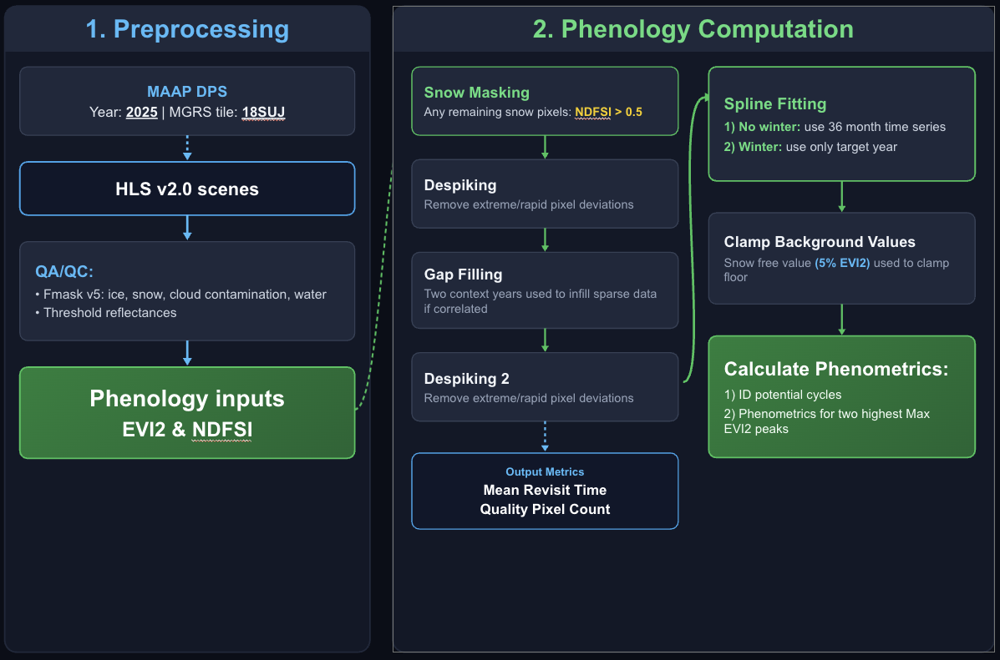
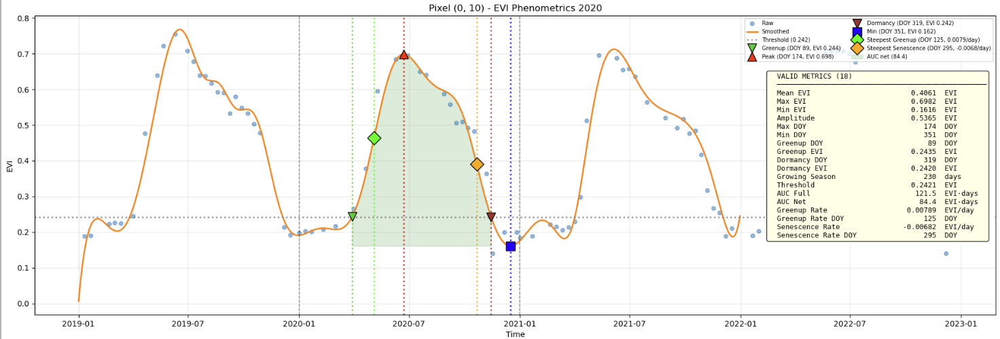

# HLS Phenometric Development Algorithm
This repository contains the code associated with generating HLS-derived phenological metrics on the MAAP Platform. It is registerd as ``hls-phenometrics:main`` and is set up to run from 2 mandatory and 1 optional user provided parameters:
- MGRS tile ID: "18SUJ"
- Target year: "2023"
- (Optional) Save scenes: "True\False" # defaults to false 
 
For the tile and target year parameters the algorithm will:
1) Download HLS spectral data from NASA EarthData including +/- 12 months around the target year, referred to as context months.
2) Calculate and save EVI2 and NDFSI tifs for every valid scene in the 36 month time window.
3) Use EVI2 and NDFSI scenes to calculate pixel-wise phenological metrics following a similar approach used by Bolton et al., 2020 with modifications to python and our implementation.

# Methodology
Phenometrics are based on a synthetically spline fit EVI2 time series for each pixel. The methodology includes:

## Phenological metrics
All metrics are calculated for up to two growing seasons identified as valid cycles with the highest peak EVI2, where applicable. Greenup onset is based on the DOY when a valid growing cycle first exceeds the greenup threshold calculated as 15% * amplitude of the current growing cycle.
- amplitude: peak EVI2 - min EVI2
- auc_full: the positive area under the curve bound by the DOYs on the x axis for greenup DOY and dormancy DOY
- auc_net: the area under the curve bound by greenup and dormancy DOYs by constrained horizontally by the y = min SVI
- cycle_count: the valid number of growing season cycles where the peak occurs in the target year
- dormancy_doy: DOY when the post peak EVI2 descending arm crosses the greenup threshold
- dormancy_evi: value corresponding to DOY (may be lower than threshold)
- greenup_doy: DOY when the ascending arm first crosses the greenup threshold prior to the peak EVI2 
- greenup_evi: corresponding EVI2 to greenup DOY (may be higher than threshold)
- greenup_rate: on the post greenup and pre peak ascending arm, the maximum first derivative or highest slope rate of change
- growing_season_length: the days between greenup DOY and dormancy DOY (Dormancy DOY - Greenup DOY)
- max_doy: DOY for max EVI2
- max_evi: global maximum (peak) EVI2 value
- mean_evi: the arithmetic average 
- mid_greenup_doy: the DOY corresponding to 50% of the amplitude on the ascending seasonal arm
- mid_greendown_doy: the DOY corresponding to 50% of the amplitude on the descending seasonal arm
- min_doy: corresponding DOY to min EVI2
- min_evi: global minimum EVI2 value

#### Auxiliary outputs
- mean_revisit_time: the average days between quality/retained scenes per pixel
- PostMaskCount: download stats, number of pixels available following FMask filtering
- PreMaskCount: download stats, numbber of pixels available before QA/QC
- quality_pixel_cnt: after QA filtering, the number of remaining observations/scenes per pixel
- qa_valid_metrics: simple count of the number of valid metrics in the output. Lower counts correspond to possibly poorer characterized regions.
- ViablePct: PostMaskCount / PreMaskCount * 100

Example of curve fitting a single forested pixel from 2020 18SUJ where "Raw" blue points are the quality data HLS scenes, "Smoothed" is the spline fit, and phenometrics are both marked on the plot and provided in the table where applicable. This plot can be reproduced with the (interactive_pheno_testing.ipynb notebook)[interactive_pheno_testing.ipynb] and 18SUJ HLS scenes from 2019-2021.

